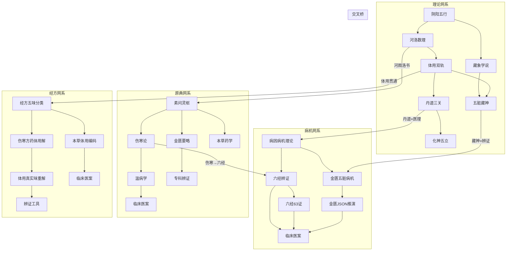

# 🕸️ 知识图谱 · 跨域关联总览

> **用途**: 展示丹道玄医录四大核心领域间的关联网络，从任意节点出发可沿脉络跳转到相关节点
> **四大网系**: 病机网系 · 经方网系 · 原典网系 · 理论网系
> **最后更新**: 2026-07-22

---

## 一、四大网系全景



---

## 二、病机网系

> 入口：病因病机 → 辨证 → 临床

### 网系脉络

```
病因病机（基础理论）
    ├── 六经辨证 → 六经63证全表 → 临床医案
    ├── 金匮五脏病机（JSON推演） → 五脏九宫矩阵 → 临床医案
    ├── 五运六气 → 多周期叠加模型 → 市场推演
    └── 西医指标体用映射 → 体用坐标
          ↓
    辨证工具（PDE引擎·舌诊·体质·西医映射）
          ↓
    临床医案（24例辨证实战）
```

### 节点详情

| 节点 | 类型 | 位置 | 关联节点 |
|:----|:----|:-----|:---------|
| 病因病机概论·河洛九宫视角 | 🏥 基础理论 | `01-个人理论/01-中医/01-基础理论/04-病因病机/` | → 素问·至真要大论(图书馆) |
| 双轨辨证体系 | 🏥 辨证论治 | `01-个人理论/01-中医/01-基础理论/05-辨证论治/` | → 六经63证 → 伤寒论 |
| 六经63证全表 | 🏥 辨证论治 | `01-个人理论/01-中医/01-基础理论/05-辨证论治/` | → 临床医案 → 伤寒来苏集 |
| 六经九宫穿行 | 🏥 辨证论治 | `01-个人理论/01-中医/01-基础理论/05-辨证论治/` | ↔ 河洛数理 → 洛书九宫 |
| 金匮五脏病机JSON | 🏥 辨证方法 | `01-个人理论/01-中医/01-基础理论/数据/金匮脏腑/` | → PDE推演引擎 → 临床医案 |
| PDE多维推演引擎 | 🛠 辨证工具 | `05-设计/引擎/` | ↔ 六经63证JSON ↔ 金匮JSON |
| 许家栋金匮病机体系 | 🏥 辨证方法 | `01-个人理论/01-中医/02-辨证方法/` | → 曹氏伤寒金匮发微(图书馆) |
| 临床医案24例 | 🏥 临床 | `01-个人理论/01-中医/03-临床医案/` | ← 全部辨证路径 → 临证指南医案 |
| 六经传变·少阴底火论 | 🏥 专题 | `01-个人理论/01-中医/07-专题研究/04-六经传变/` | → 伤寒论·少阴篇 |

---

## 三、经方网系

> 入口：经方分类 → 本草编码 → 方药重解 → 临床

### 网系脉络

```
经方五味分类（7卷数据库）
    ├── 辛甘化苦类（53方最大群）
    ├── 辛酸化辛类（18方）
    ├── 苦甘化咸类（18方）
    ├── 辛咸化滞类（6方）
    ├── 酸苦化甘类（9方）
    ├── 辛苦化甘类（4方）
    └── 咸苦化酸类（6方）
          ↓
    本草体用九转坐标（73味药）
          ↓
    伤寒方药体用解 + 体用真实味重解
          ↓
    临床医案验证
```

### 节点详情

| 节点 | 类型 | 位置 | 关联节点 |
|:----|:----|:-----|:---------|
| 经方五味分类数据库 | 🏥 药学 | `01-个人理论/01-中医/05-药学/01-经方数据库/` | → 伤寒杂病论性味化合新解 |
| 本草体用九转坐标 | 🏥 药学 | `01-个人理论/01-中医/05-药学/02-本草药性体用编码/` | ↔ 河图四象五味体用 |
| 伤寒方药体用解 | 🏥 药学 | `01-个人理论/01-中医/05-药学/03-伤寒方药体用解/` | → 甘草泻心汤 → 长沙药解 |
| 体用真实味重解 | 🏥 药学 | `01-个人理论/01-中医/05-药学/04-体用真实味经方重解/` | ↔ 辅行诀(图书馆) |
| 五味体用补泻总表 | 🔢 数理 | `01-个人理论/04-融合/01-数理根本/01-河洛数理/` | ↔ 汤液本草(图书馆) |
| 河图四象五味体用 | 🔢 数理 | `01-个人理论/04-融合/01-数理根本/01-河洛数理/` | → 经方五味分类 ← 辅行诀 |
| 辩证用药要诀 | 🏥 药学参考 | `01-个人理论/01-中医/05-药学/` (顶层) | ↔ 本草纲目(图书馆) |
| 戊己甘淡辨·河图土德 | 🔢 数理 | `01-个人理论/04-融合/01-数理根本/01-河洛数理/` | → 脾胃论(图书馆) |

---

## 四、原典网系

> 入口：素问灵枢 → 伤寒金匮 → 温病专科 → 历代各家

### 网系脉络

```
素问灵枢（内经根基）
    ├── 素问18本 → 伤寒论49本 → 金匮11本
    ├── 灵枢5本 → 经络9本 → 针灸41本
    ├── 难经7本 → 脉学26本
    └── 素问→温病13本（卫气营血·三焦）
          ↓
    辨证诊治20本 → 医理集论73本 → 医部全录123本
          ↓
    专科30类（妇科·儿科·外科·五官·养生…）
          ↓
    医案33本 → 海外9本（医心方等）
```

### 原典→活跃层桥接（精选）

| 图书馆原典 | 活跃层对应 | 索引文件 |
|:----------|:----------|:--------|
| 素问·阴阳应象大论 | 阴阳五行概论 | `理论→原典交叉检索.md` |
| 伤寒论 | 双轨辨证体系、六经63证全表 | `理论→原典交叉检索.md` |
| 金匮要略 | 金匮辨证玉册、五脏病机JSON | `理论→原典交叉检索.md` |
| 温病条辨 | 三焦辨证体用打通 | `理论→原典交叉检索.md` |
| 辅行诀 | 五味体用辨、经方五味分类 | `理论→原典交叉检索.md` |
| 脉经 | 二十四脉象体系 | `理论→原典交叉检索.md` |
| 临证指南医案 | 全部24例临床医案 | `理论→原典交叉检索.md` |
| 傅青主女科 | 妇科体用双轨 | `理论→原典交叉检索.md` |

> 完整桥接见 `理论→原典交叉检索.md`（活跃层→图书馆）和 `原典→理论反向桥接.md`（图书馆→活跃层）

---

## 五、理论网系

> 入口：阴阳五行 → 河洛数理 → 体用双轨 → 丹道三关 → 化神五立

### 网系脉络

```
阴阳五行
    ├── 河图洛书体用新解 → 洛书九宫·八维三才表
    │         ↓
    │   河图生成数与脏腑配属 → 五脏九宫矩阵
    │         ↓
    │   五味体用补泻总表 → 九转编码引擎
    ├── 藏象学说 → 五脏藏神辩证 → 化神五立
    ├── 中医气与丹道炁 → 卦象分层模型
    └── 五运六气 → 体用打通 → 市场推演
          ↓
    体用双轨（贯穿全体系的核心方法论）
          ↓
    丹道三关（炼精化炁→炼炁化神→炼神还虚）
          ↓
    化神五立（心神·肝魂·脾意·肺魄·肾志）
```

### 体用双轨——核心骨干

体用双轨是贯穿整个知识体系的方法论骨干：

```
               体用双轨
        ┌─────────┴─────────┐
        ▼                   ▼
    中医辨证体用         丹道修炼体用
    ┌────┼────┐        ┌────┼────┐
    本草  辨证  临床    炼精  炼炁  炼神
    体用  体用  体用    化炁  化神  还虚
    编码  贯通  验证    体用  体用  体用
```

| 体用应用领域 | 位置 |
|:-----------|:-----|
| 河图四象五味体用双轨 | `01-个人理论/04-融合/01-数理根本/01-河洛数理/` |
| 双轨辨证体系 | `01-个人理论/01-中医/01-基础理论/05-辨证论治/` |
| 时方体用双轨 | `01-个人理论/01-中医/02-辨证方法/个人辨证扩展/` |
| 妇科体用双轨 | `01-个人理论/01-中医/04-专科辨证/01-妇科体用双轨/` |
| 儿科体用双轨 | `01-个人理论/01-中医/04-专科辨证/02-儿科体用双轨/` |
| 外科五层体用 | `01-个人理论/01-中医/04-专科辨证/03-外科五层体用/` |
| 本草体用九转坐标 | `01-个人理论/01-中医/05-药学/02-本草药性体用编码/` |
| 体质学体用向量 | `01-个人理论/01-中医/06-辨证工具/03-体质学体用向量/` |
| 温病体用贯穿 | `01-个人理论/01-中医/07-专题研究/01-温病体用贯穿/` |
| 五运六气体用打通 | `01-个人理论/01-中医/07-专题研究/03-五运六气体用打通/` |
| 丹道体用临床转化 | `01-个人理论/02-丹道/01-修炼次第/` |
| 丹道要药体用编码 | `01-个人理论/02-丹道/01-修炼次第/` |

---

## 六、交叉桥——跨域枢纽

### 中医 × 丹道（体用贯通）

```
中医辨证体用 ←→ 丹道修炼体用
        ↑                 ↑
  五味体用补泻表    火候定量河图数理
        ↓                 ↓
  经方体用重解   ←→  丹道要药体用编码
```

| 桥梁节点 | 中医侧 | 丹道侧 |
|:--------|:------|:------|
| 气与炁 | 中医气与丹道炁·卦象分层模型 | `01-个人理论/01-中医/01-基础理论/01-阴阳五行/` |
| 三观三关 | 丹道三关与中医三观·范畴辨异 | `01-个人理论/02-丹道/02-体悟理论/` |
| 体用融合 | 丹道体用临床转化 | `01-个人理论/02-丹道/01-修炼次第/` |

### 河洛 × 医理

```
河图洛书数理 ─┬── 五味体用补泻表 ──→ 经方五味分类
               ├── 五脏九宫矩阵 ───→ 金匮五脏病机
               ├── 洛书九宫穿行 ───→ 六经九宫辨证
               └── 河图舌诊体用 ───→ 舌诊图片数据库
```

### 丹道 × 玄学

```
丹道火候 ←→ 河图数理 ←→ 洛书九宫 ←→ 奇门遁甲
                ↓
           六十四卦 ↔ 干支纪年
                ↓
           五运六气市场推演
```

### 玄学 × 临床

| 桥梁 | 玄学侧 | 临床侧 |
|:----|:------|:------|
| 奇门病机诊断法 | 奇门遁甲 | `01-个人理论/01-中医/02-辨证方法/个人辨证扩展/` |
| 奇门经脉穴位映射 | 奇门遁甲 | `01-个人理论/01-中医/04-专科辨证/04-针法研究/` |
| 九宫飞星针法 | 玄学九宫 | `01-个人理论/04-融合/02-交叉创新/01-交叉发明/` |
| 二十四脉象玄学融合 | 玄学体系 | `01-个人理论/01-中医/02-辨证方法/个人辨证扩展/` |

---

## 七、数据流——JSON 推演链条

```
金匮五脏病机JSON（53条）
    ↓ 加载
PDE多维推演引擎
    ↓ 加载
六经63证JSON数据库
    ↓
    因果推理引擎 → 知识引擎 → 反馈学习
    ↓
临床医案验证 → 方剂库 → 体用坐标训练
    ↓
紫微斗数桥接（zwds_pde_bridge）
```

| JSON数据 | 位置 | 引擎模块 |
|:--------|:-----|:---------|
| 金匮五脏病机推演 | `01-个人理论/01-中医/01-基础理论/数据/金匮脏腑/` | pde_engine |
| 六经63证 | `01-个人理论/01-中医/02-辨证方法/数据/六经63证/` | enhance_six_channels |
| 训练数据16模块 | `06-灵汐档案/训练数据/` | feedback_learner |

---

## 八、快速导航——六跳直达

| # | 入口 | 第一跳 | 第二跳 | 第三跳 | 第四跳 | 第五跳 | 第六跳 |
|:-|:----|:------|:------|:------|:------|:------|:------|
| 1 | 六经辨证 | 六经63证全表 | 伤寒来苏集 | 伤寒论原文 | 经方五味分类 | 临床医案 | 临证指南医案 |
| 2 | 病机 | 病因病机·河洛视角 | 素问·至真要大论 | 金匮五脏JSON | PDE引擎 | 临床医案 | — |
| 3 | 本草 | 本草体用编码 | 神农本草经 | 经方数据库 | 五味体用补泻 | 河图四象 | — |
| 4 | 体用 | 体用双轨体系 | 妇科/儿科/外科体用 | 丹道体用转化 | 化神五立 | — | — |
| 5 | 丹道 | 丹道三关 | 参同契 | 火候河图数理 | 中医三观辨异 | 化神五立 | — |
| 6 | 河洛 | 洛书九宫表 | 河图脏腑配属 | 五味体用补泻 | 九转编码 | 五脏九宫矩阵 | 辅行诀 |

---

## 🔗 关联导航

| 文件 | 用途 |
|:----|:-----|
| `总索引.md` | 活跃层全览 |
| `理论→原典交叉检索.md` | 理论概念→图书馆原典 |
| `原典→理论反向桥接.md` | 图书馆原典→活跃层理论 |
| `病名×脉象×方剂交叉索引.md` | 临床辨证三路速查 |
| `学习路线图.md` | 学习路径规划 |
| `阅读清单.md` | 推荐书单 |
| `训练数据总索引.md` | 🆕 16模块训练数据索引 |
