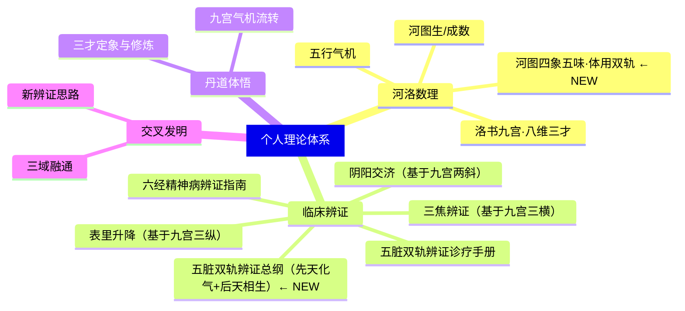

# 🧬 灵汐理论体系 · 总纲

> **创建日期**: 2026-05-03
> **核心思想**: 以洛书九宫为器，八维三才为路，河图生/成数定脏腑，构建全息辨证与修炼的理论框架
> **状态**: 🟢 活跃

---

## 🧭 理论版图

---

## 📐 理论来源

| 来源 | 说明 | 链接 |
|------|------|------|
| 洛书九宫 | 九宫数字布局，八线每组和=15 | [[洛书九宫·八维三才 全维总表]] |
| 河图生成数 | 1-10 数分生/成，定脏腑阴阳 | [[河图生成数与脏腑配属]] |
| **河图四象五味·体用双轨** | **四象五味+五脏体用二分+双轨辨证，独门诊疗心法** | **[[河图四象五味-五脏体用双轨体系]]** |
| **五脏双轨辨证诊疗手册** | **河图体用性味版·五脏各论方药针法完整手册** | **[[河图体用性味-五脏双轨辨证诊疗手册]]** |
| **五脏双轨辨证总纲** | **先天化气逆传治虚+后天相生顺传治实·定式框架** | **[[五脏双轨辨证总纲（先天化气逆传+后天相生顺传）]] ← NEW** |
| 三才定象 | 模3余1=天，余2=地，余0=人 | 详见总表 |
| 中医经典 | 黄帝内经脏腑经络 | [[黄帝内经/...]] |
| 丹道经典 | 内丹三关修炼 | [[丹道经典导读]] |

---

## 🔗 快速入口

| 领域 | 入口笔记 | 状态 |
|------|----------|------|
| 🏛️ **河洛数理** | [[河洛数理/总索引]] | 🟢 |
| 🏥 **临床辨证** | [[临床辨证/总索引]] | 🟡 待补充 |
| ☯️ **丹道体悟** | [[丹道体悟/总索引]] | 🟡 待补充 |
| 🧠 **五脏藏神辩证** | [[06-五脏藏神辩证/总纲-五脏藏神辩证纲领]] | 🟢 |
| 🔀 **交叉发明** | [[交叉发明/总索引]] | 🟡 待补充 |

---

## 📝 理论状态标记

每条理论/见解使用以下标签标记状态：

- `#理论/成形` — 已定型，可直接使用
- `#理论/发展中` — 还在完善中
- `#理论/待验证` — 推理完成但未经验证
- `#理论/疑问` — 存疑待解

应用场景标记：

- `#应用/辨证` — 可用于中医辨证
- `#应用/修炼` — 可用于丹道修炼
- `#应用/占卜` — 可用于玄学命理
- `#应用/养生` — 可用于日常养生

---

> 本体系持续生长中。每条理论都应可追溯、可检索、可应用。
